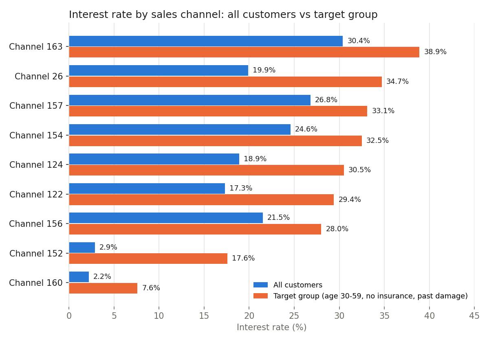
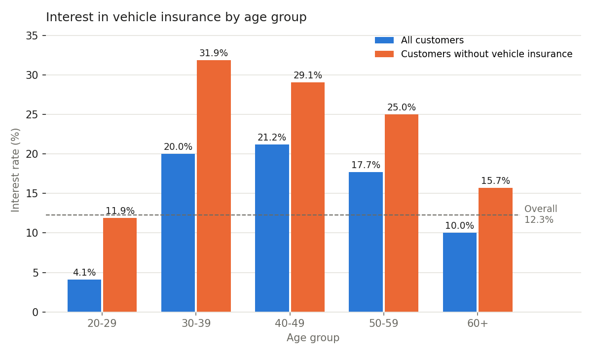

# Insurance Cross-Sell Analysis with SQL

SQL project in Google BigQuery. Which existing health insurance customers are most likely to buy vehicle insurance?

## Business Questions

1. What share of customers want to buy vehicle insurance?
2. Which age groups show the most interest?
3. Do customers with past vehicle damage show more interest?
4. Which sales channels work best?
5. Who should the next sales campaign target?

## Dataset

- Source: [Health Insurance Cross Sell Prediction, Kaggle](https://www.kaggle.com/datasets/anmolkumar/health-insurance-cross-sell-prediction)
- 381,109 customers of a health insurance company in India
- Fields include age, gender, region, existing vehicle insurance, vehicle age, past vehicle damage, annual premium, sales channel and response (interested or not)
- Tool: Google BigQuery Sandbox, standard SQL

## Data Checks

- All 381,109 customer IDs are unique. No duplicate rows.
- No blank cells in any column.
- Age ranges from 20 to 85.
- 64,877 customers (17.0%) pay exactly 2,630, the minimum premium. Kept as valid values.
- Only 778 customers (0.2%) pay above 100,000. Kept, since they are too few to affect the results.
- The premium median (31,667) sits above the mean (30,564), because the minimum premium group pulls the mean down. Premium comparisons use the median.

## SQL Skills Used

- `CASE WHEN` to group customers by age and segment
- `GROUP BY` with 1 and 2 columns
- `COUNTIF` and conditional `AVG` for rates
- `APPROX_QUANTILES` for the median and the 99th percentile
- Window functions (`SUM(...) OVER ()`) for the share of each group
- `WHERE` filters for a fair comparison between channels

All queries are in [`analysis.sql`](analysis.sql).

## Key Findings

1. Only 12.3% of customers want vehicle insurance (46,710 of 381,109). Every group below is compared with this rate.
2. Customers who already have vehicle insurance show almost no interest. Of 174,628 such customers, only 158 said yes.
3. Customers with no vehicle insurance and past vehicle damage make up 47.9% of all customers but 97.7% of interested customers. Their interest rate is 25.0%.
4. Age 20-29 is the largest group (40.7% of customers) with the lowest interest (4.1%). 65.8% of them already have vehicle insurance. Without these, their rate rises to 11.9%, still the lowest of all age groups.
5. Age 30-39 without vehicle insurance shows the highest interest, at 31.9%.
6. Channel 152 serves the most customers (35.4%) but converts only 2.9%. Its customers average 26 years old. With the target group only, its rate rises to 17.6%, still half the rate of Channel 26 (34.7%). The low result comes mostly from who it reaches, and partly from how it sells.
7. Channel 160 stays weak even with the target group (7.6%).
8. The target group (age 30-59, no vehicle insurance, past vehicle damage) is 29.6% of customers but 75.0% of interested customers. Its interest rate is 31.1%, 7 times the rest (4.3%). Its median premium is also 5.2% higher.

## Recommendations

1. Remove customers who already have vehicle insurance from the call list. This cuts 45.8% of calls and loses only 158 interested customers.
2. Focus the next campaign on the target group. An agent reaches 1 interested customer in every 3 calls, compared with 1 in 23 for the rest.
3. Send target group leads through Channel 26 for scale (34.7%, 37,562 target customers).
4. Review Channel 160 and the sales approach of Channel 152.

## Limits of This Analysis

- The data comes from India. Customer behaviour in Malaysia and in the takaful market is likely to differ.
- Response shows interest, not a completed purchase.
- Sales channel names are hidden as codes, so the analysis does not say what each channel is.
- Channel 151 has only 75 target customers, too few for a conclusion.
- The analysis shows links between customer traits and interest. It does not prove cause.

## Files

- `analysis.sql`: all 9 queries with results noted
- `chart_channel.png`: interest rate by sales channel, all customers vs target group
- `chart_age.png`: interest rate by age group
